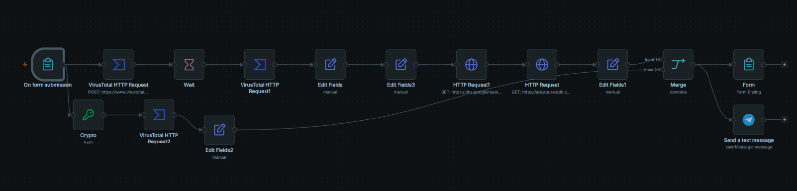

# Automated Threat Detection Workflow (n8n)

An n8n workflow that takes a URL and/or a file from a web form, checks it against free threat-intelligence APIs plus a rule-based phishing heuristic, and delivers one combined result on screen and to Telegram. No manual lookups.

Built as a cybersecurity capstone project. The full written report is in [`docs/`](docs/).



## What it does

A single form submission triggers four checks:

| Check | How | Tool |
|---|---|---|
| **URL reputation** | Submits the URL, waits for the scan, retrieves the result | VirusTotal API |
| **IP reputation** | Resolves the URL's domain to an IP, then checks the IP | Google Public DNS + AbuseIPDB |
| **File reputation** | Hashes the uploaded file (SHA-256) and looks the hash up | n8n Crypto node + VirusTotal API |
| **Phishing indicators** | Scores the URL against six rule-based factors | n8n Edit Fields expression |

Raw API output is reduced to short verdicts, and a **Merge** node combines the branch results into one item. That item is shown on the form's ending page and sent to **Telegram** at the same time.

- **URL:** `Malicious` if any VirusTotal engine flags it, otherwise `Clean`
- **IP:** `Suspicious IP` if the AbuseIPDB confidence score is above 25, otherwise `Clean IP`
- **File:** consolidated from the VirusTotal hash lookup
- **Phishing:** `Possible Phishing Indicators` if the score is 2 or more

### Phishing heuristic

One point for each factor present in the URL:

1. Contains an `@` symbol
2. Uses an IP address instead of a domain
3. Plain `http://` instead of `https://`
4. More than 3 hyphens
5. Longer than 75 characters
6. Contains lure keywords: `login`, `verify`, `secure`, `account`, `update`, `confirm`

This is a simple heuristic, not a trained model. It will produce false positives and misses.

## Architecture

```
On form submission
 ├─ VirusTotal (POST /urls) → Wait → VirusTotal (GET /analyses/{id}) → Edit Fields (URL verdict, phishing score)
 │     → DNS lookup (dns.google) → AbuseIPDB → Edit Fields1 (IP verdict) ─┐
 └─ Crypto (SHA-256) → VirusTotal (GET /files/{hash}) → Edit Fields2 ──────┤
                                                                           ▼
                                                                         Merge
                                                                    ┌──────┴──────┐
                                                              Form Ending     Telegram
```

Files are never uploaded. Only the hash is sent, which is faster and avoids transmitting file content.

## Design decisions

- **IP derived from the URL.** Instead of asking the user for an IP, the workflow resolves it through DNS. One input produces a cross-referenced assessment.
- **Hash lookup instead of file upload.** VirusTotal already holds results for previously seen files, so a hash is enough to get a verdict.
- **One combined output.** A Merge node joins all branches so the user gets a single result instead of separate verdicts.
- **Free tools only.** HaveIBeenPwned was considered for email checks but its API is now paid, so it is not included.

## Test results

| Input | Result |
|---|---|
| `google.com`, `wikipedia.org`, `example.com` | Clean (0 engines flagged) |
| IPs resolved from those domains | Clean (low abuse confidence scores) |
| Novel 26-byte text file | Not found in VirusTotal (expected for a never-seen file) |
| [EICAR test file](https://www.eicar.org/) | Malicious: 22 of 61 engines flagged; sandbox classified it as MALWARE / TROJAN; result delivered via Telegram |
| `http://example.com/secure-login-verify-account-update-confirm-now` (constructed safe test URL) | Phishing score 3: Possible Phishing Indicators |
| Clean URL | Phishing score 0 |

The EICAR file is a harmless, industry-standard antivirus test string. The 22/61 rate is expected: many heuristic engines do not flag a plain-text signature, while signature-based engines do.

## Setup

1. Get n8n: a free [n8n Cloud](https://n8n.io) trial, or self-host (for example `npx n8n`).
2. Import `workflow.json` (Workflows → Import from file).
3. Get free API keys:
   - [VirusTotal](https://www.virustotal.com) → create an n8n **VirusTotal API** credential and select it on the VirusTotal nodes.
   - [AbuseIPDB](https://www.abuseipdb.com) → paste the key into the `Key` header of the AbuseIPDB HTTP Request node, replacing `YOUR_ABUSEIPDB_KEY`.
4. Set up Telegram:
   - Create a bot with [@BotFather](https://t.me/BotFather) and add its token as a Telegram credential in n8n.
   - Replace `YOUR_TELEGRAM_CHAT_ID` in the Telegram node with your own chat ID.
5. Open the form trigger node, use the test URL, and submit a URL (and optionally a file).

## Lessons learned

Real issues hit while building this, and how they were fixed:

- **Expressions need Expression mode.** An HTTP Request field set to *Fixed* sends the literal `{{ ... }}` text to the API, which caused a "resource not found" error. Reading the raw request log showed it.
- **The form trigger can't reference downstream nodes** ("no path back to node"). The fix was a separate n8n **Form Ending** node after Merge.
- **HTTP Request nodes drop upstream fields.** Fixed with the *Include Other Input Fields* toggle and explicit `$('NodeName')` references.
- **DNS lookup broke on URLs with a path.** Fixed by keeping only the host part with `.split('/')[0]`.
- **A Manual Mapping field can't reference a sibling field in the same node.** The phishing scoring expression had to be written inline.

## Limitations

- Hash lookups only identify files VirusTotal has seen before. A novel malicious file will not be flagged, and no dynamic or sandbox analysis is performed.
- The phishing check is a fixed rule set. It does not inspect page content, redirects or domain age.
- Free-tier rate limits (VirusTotal: 4 requests/minute) cap throughput.
- The IP threshold (25) and phishing threshold (2) are reasonable defaults, not derived from a formal risk model.
- No email or breach checking.

## Possible next steps

- Log every check to a Google Sheet or database
- Add a second URL source such as Google Safe Browsing for cross-referencing
- Add domain age (WHOIS) as a phishing factor

## Tech

n8n · VirusTotal API v3 · AbuseIPDB API v2 · Google Public DNS (DoH) · Telegram Bot API

## Author

Haripriya Joshy, MSc Cybersecurity

## License

MIT
